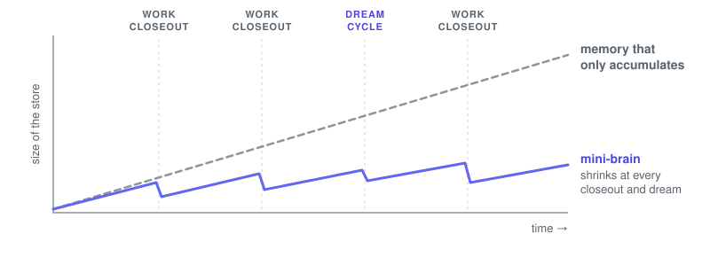
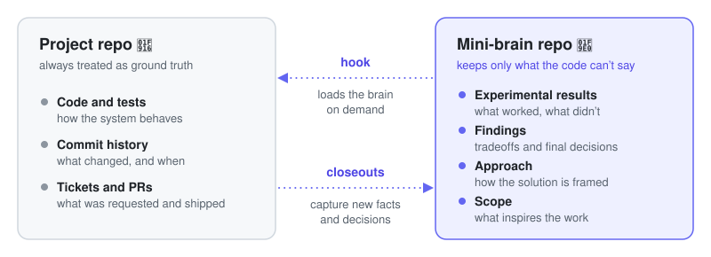
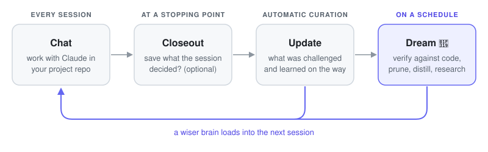
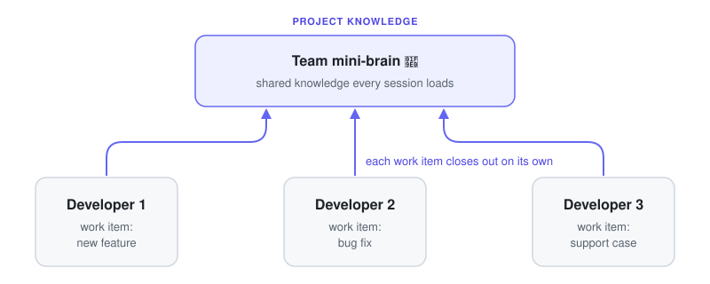

# mini-brain-toolkit 🧠

[](https://claude.ai/code)
[](https://github.com/robfromboulder/mini-brain-toolkit/blob/main/CONTRIBUTING.md)
[](https://github.com/robfromboulder/mini-brain-toolkit/blob/main/LICENSE)

Using a **mini-brain** with your codebase helps you iterate and triage faster, and gives your coding agent better context to make changes autonomously. This free toolkit provides skills for creating and checking mini-brains.

Contents:

* [What is a mini-brain?](#what-is-a-mini-brain)
* [Installing the toolkit](#installing-the-toolkit)
* [Creating a mini-brain](#creating-a-mini-brain)
* [Checking a mini-brain](#checking-a-mini-brain)
* [Inside a mini-brain](#inside-a-mini-brain)

## What is a mini-brain?

There are many good tools for giving AI agents memory and context, but too many merely accumulate. Every interaction adds to the knowledge store or "second brain", and this grows and drifts over time.

A mini-brain only captures knowledge about your software project that **can't be derived from code or commit history**: what inspires the work, why decisions went one way and not another, what was tried and discarded, what was surprising. A mini-brain doesn't repeat anything your codebase already knows, but curates important details that are easily forgotten or scattered across tickets, wikis, and project documentation.

<picture>
  <source media="(prefers-color-scheme: dark)" srcset=".github/images/curate-not-accumulate-dark.svg">
  
</picture>

**Using a mini-brain is just chatting with your coding agent.** Mention the mini-brain in any session, and a hook in your project repo loads it on demand. Your agent reads only the parts it needs, and uses them for research, coding, or triage. At a natural stopping point, you'll be prompted to optionally save what the session decided and learned. There are no formats to learn, no files to copy, and you never leave the repo you're working in.

<picture>
  <source media="(prefers-color-scheme: dark)" srcset=".github/images/what-goes-where-dark.svg">
  
</picture>

**Mini-brains are self-improving.** On a schedule, a mini-brain dreams: verifying its claims against the code, pruning what's become derivable, and doing follow-on research. The brain stays small enough to read completely, and curious about what it doesn't know. Each dream cycle re-evaluates drift between the codebase, the mini-brain, and the tools and platforms they depend on.

<picture>
  <source media="(prefers-color-scheme: dark)" srcset=".github/images/lifecycle-dark.svg">
  
</picture>

**Mini-brains are built for software teams.** Each feature, bug fix, or support case can be a *work item* with its own working notes, so several teammates can research at once without stepping on each other. When a work item closes out, what it learned is folded into the team's shared knowledge through a PR, reviewable like any other code. A mini-brain is just Markdown files in a dedicated git repo alongside your project repos, and teammates and their agents all work from the same brain.

<picture>
  <source media="(prefers-color-scheme: dark)" srcset=".github/images/team-curation-dark.svg">
  
</picture>

## Installing the toolkit

Use the command below for your harness to install the toolkit skills, or to update to the latest release.

**Claude Code**

```sh
d=~/.claude/skills/mini-brain-toolkit; if [ -d "$d" ]; then git -C "$d" fetch -q --tags; else git clone -q https://github.com/robfromboulder/mini-brain-toolkit "$d"; fi && git -C "$d" checkout -q "$(git -C "$d" tag --sort=-v:refname | head -1)"
```

**Codex**

```sh
d=~/.agents/skills/mini-brain-toolkit; if [ -d "$d" ]; then git -C "$d" fetch -q --tags; else git clone -q https://github.com/robfromboulder/mini-brain-toolkit "$d"; fi && git -C "$d" checkout -q "$(git -C "$d" tag --sort=-v:refname | head -1)"
```

**OpenCode 2**

```sh
d=~/.agents/skills/mini-brain-toolkit; if [ -d "$d" ]; then git -C "$d" fetch -q --tags; else git clone -q https://github.com/robfromboulder/mini-brain-toolkit "$d"; fi && git -C "$d" checkout -q "$(git -C "$d" tag --sort=-v:refname | head -1)"
```

**Other harnesses**

```sh
d=~/mini-brain-toolkit; if [ -d "$d" ]; then git -C "$d" fetch -q --tags; else git clone -q https://github.com/robfromboulder/mini-brain-toolkit "$d"; fi && git -C "$d" checkout -q "$(git -C "$d" tag --sort=-v:refname | head -1)"
```

## Creating a mini-brain

The `create` command helps seed a new mini-brain, whether you're starting a brand new project or adding a mini-brain to an existing codebase. It asks a few questions, configures knowledge files in a dedicated repo for the mini-brain, and hooks the brain into your project repos.

**Claude Code**

```
/mini-brain-toolkit create
```

**Codex**

```
$mini-brain-toolkit create
```

**OpenCode 2** (select the skill from the menu `@` opens, rather than copying and pasting)

```
@mini-brain-toolkit create
```

**Other harnesses**

```
Read ~/mini-brain-toolkit/SKILL.md and run create
```

## Checking a mini-brain

The `check` command evaluates your mini-brain and suggests how to improve its structure and function. It asks which brains to check, then walks you through the recommendations it finds. It also brings the brain's procedures up to date with the installed toolkit, so updating the toolkit and running `check` is the whole upgrade.

**Claude Code**

```
/mini-brain-toolkit check
```

**Codex**

```
$mini-brain-toolkit check
```

**OpenCode 2** (select the skill from the menu `@` opens, rather than copying and pasting)

```
@mini-brain-toolkit check
```

**Other harnesses**

```
Read ~/mini-brain-toolkit/SKILL.md and run check
```

## Inside a mini-brain

Most knowledge systems handle storing and retrieving knowledge, and leave its structure to you. A mini-brain comes with its structure already decided: which document each kind of fact belongs in, how a work item merges into those documents, and how a brain divides when a project holds several problems.

<picture>
  <source media="(prefers-color-scheme: dark)" srcset=".github/images/inside-a-mini-brain-dark.svg">
  
</picture>
